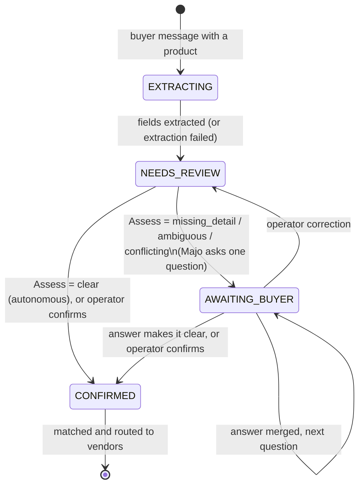
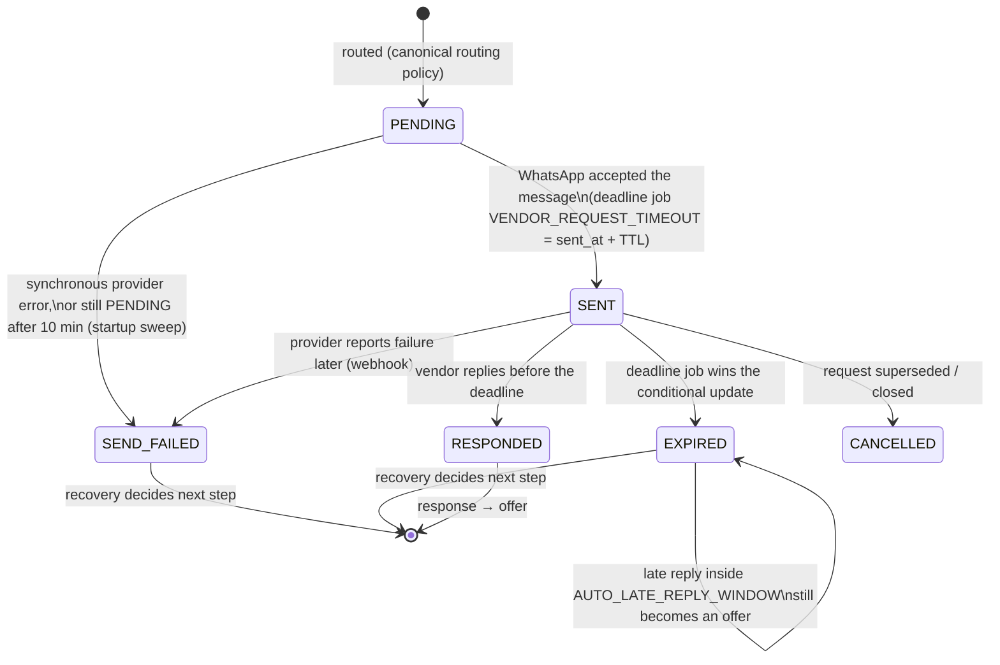
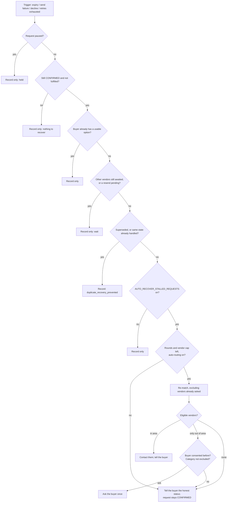
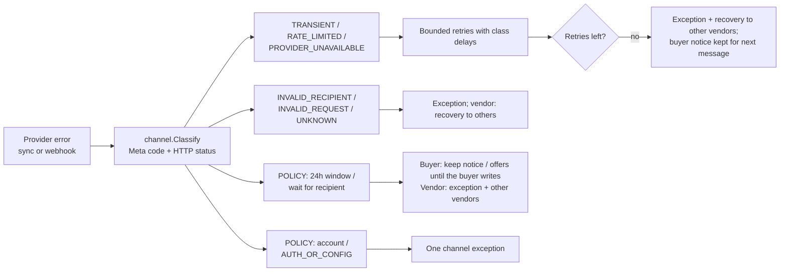
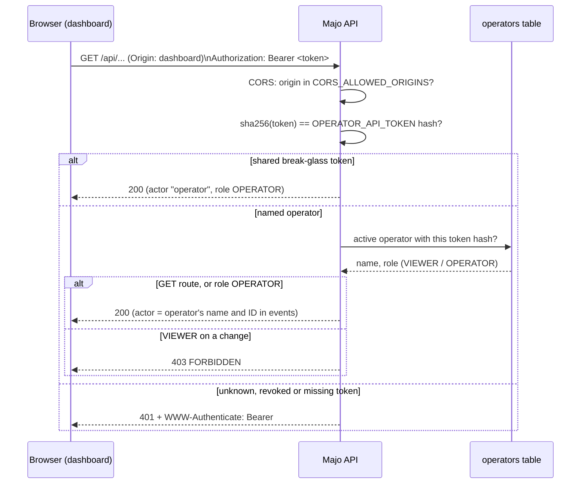

# Majo flow diagrams

Mermaid diagrams (reuse-audit R0: GitHub and most Markdown viewers render
` ```mermaid ` blocks; no tool to install). They summarise behaviour that is
specified in prose elsewhere; when the two disagree, the code and the prose
docs win and this file must be corrected.

## 1. Buyer request: from message to confirmed request

Source: `internal/request/request.go`, `internal/workflow/assess.go`,
`docs/architecture/autonomous-runtime.md`.



A restricted item (`policy_exception`) is not confirmed: it stays unconfirmed
with an open exception. Correcting a CONFIRMED request keeps it CONFIRMED
(`RequestRepository.UpdateFields`).


Only a CONFIRMED request may be matched, routed, offered or selected
(`request.ErrNotConfirmed`). Greetings and thank-yous never create a request.

## 2. Vendor request lifecycle

Source: `internal/routing/routing.go`, `internal/workflow/timeout.go`.



## 3. Recovery decision (`RecoverRequest`)

Runs under the request's workflow lock after an expiry, a send failure, a
decline or exhausted retries. Every outcome is recorded as a
`RECOVER_REQUEST` decision.



## 4. Outbound failure handling

Source: `internal/channel/failure.go`, `docs/architecture/whatsapp.md`.



## 5. Operator access (reuse-audit R1)

Source: `internal/httpserver/operator_auth.go`, `internal/access`,
`cmd/operatorctl`.


